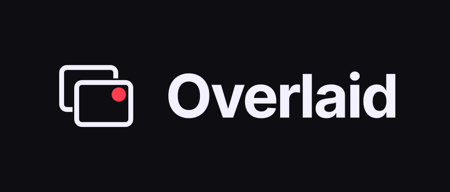

# Overlaid



Overlaid is a stream desk for one person doing every job. It runs beside OBS on
your own machine and puts the overlays, the Twitch chat bot, the scene controls
and the health check on one screen. A Newsroom section helps you prepare and
run reaction shows.

It is in development. There is no public instance and no named release yet.
Twitch is the only supported platform.

## Features

- **Overlays.** OBS browser sources for alerts, chat, goals, now playing,
  ticker, camera frame, starting, BRB and ending screens, a Newsroom card and a
  debug inspector. Each one has an offline `?demo=1` preview. The Overlays page
  copies each source URL with a read-only key.
- **OBS control.** Switch scenes, toggle inputs and scene items, run quick
  actions and sequences, rehearse a session, and manage the BRB screen from the
  desk through OBS WebSocket v5. An optional missing-input fallback rule
  proposes a backup scene and waits for you to approve it.
- **Twitch events.** EventSub feeds chat, alerts and channel-point rewards into
  the overlays after you connect your account with OAuth.
- **Chat bot.** Custom commands and replies, timers, counters, quotes, API
  variables, moderation rules, nuke previews and channel-point reward queues.
- **Newsroom.** Collect audience links and questions, triage them in a
  moderator queue, build the reaction deck and segments, keep shelves for later,
  and save play notes. Export notes and chapters as Markdown, send them to a
  Discord webhook, or publish a revocable public episode page or shared shelf.
  A [browser extension](extension/) adds links. Optional providers add link
  metadata, YouTube playlist imports, AI analysis and related coverage.
- **Health and sessions.** A readiness page with Twitch and EventSub
  diagnostics and build information, plus session reports, exports and event
  history.
- **Accounts and workspaces.** With PostgreSQL: account sessions, member roles,
  encrypted provider credentials, retention, exports and deletion.

Twitch and OBS features need their connections and permissions. AI analysis
and new Newsroom chat entries start turned off. [Current capabilities and
limits](docs/reference/project-status.md) describes which features are on by
default and which need explicit configuration.

## Quick start

You need Git, Docker and Docker Compose. The images build the app, so Go and
Node are only needed for native development.

```bash
git clone https://github.com/subculture-collective/overlaid.git
cd overlaid
cp .env.example .env
```

Edit `.env` before starting:

1. Set different values for `POSTGRES_PASSWORD` and
   `OVERLAID_DATABASE_PASSWORD`. Use URL-safe values, and put the runtime
   password in `DATABASE_URL` too. Keep the `overlaid_app` user in that URL.
2. For a first local run, leave `DEPLOYMENT_MODE=selfhost`,
   `EXPOSURE_MODE=local` and both `TWITCH_CHAT_*_MODE` settings at `legacy`.
3. Before connecting Twitch or saving provider keys, generate a vault key with
   `openssl rand -base64 32` and set `VAULT_ACTIVE_KEY=v1` and
   `VAULT_KEYS=v1:<generated-key>`. Keep the key with your backups.

Start the stack:

```bash
docker compose up --build -d
docker compose ps
```

Then open the [dashboard](http://localhost:5173/dashboard), the
[Newsroom demo](http://localhost:5173/dashboard/newsroom?demo=1) or an
[overlay demo](http://localhost:5173/overlay/alerts?demo=1). The API listens on
port 8080 and PostgreSQL on 55432.

A fresh PostgreSQL volume applies every migration and creates a separate
non-owner runtime login. Rebuilding an image does not migrate an existing
database; use `make db-migrate` and read
[tenancy and recovery](docs/runbooks/tenancy-and-recovery.md) first.

Compose publishes host ports, so keep the local settings to a trusted machine
or network. [Getting started](docs/runbooks/getting-started.md) covers
connecting Twitch and OBS, native development, and what to set before sharing
a running instance.

## Dashboard pages

| Page | Purpose |
| --- | --- |
| `/dashboard` | On-air controls, session tally, preflight and recent events |
| `/dashboard/scenes` | OBS scenes, inputs and items, fallbacks, quick actions, sequences and rehearsals |
| `/dashboard/chat` | Bot commands, timers, counters, quotes, moderation and rewards |
| `/dashboard/newsroom` | Editorial queue, reaction deck, shelves, shows and notes |
| `/dashboard/overlays` | Previews, browser-source URLs, display settings and setup |
| `/dashboard/health` | Readiness, recovery tools, EventSub diagnostics and build information |
| `/dashboard/settings` | Shared configuration, automation profiles and integrations |
| `/dashboard/sessions` | Stream and rehearsal sessions, reports, exports and history |
| `/dashboard/account` | Workspace access, membership, credentials, retention, exports and deletion |

Overlay routes live under `/overlay/` (`alerts`, `chat`, `goals`,
`now-playing`, `ticker`, `camera`, `starting`, `brb`, `ending`, `newsroom`,
`debug`). The [overlay reference](docs/runbooks/overlays.md) lists sizes and
parameters. Never put the operator secret in an OBS URL.

## Configuration

Settings are environment variables; [`.env.example`](.env.example) lists them
with comments.

- Deployment: `DEPLOYMENT_MODE` (`selfhost` or `hosted`), `EXPOSURE_MODE`
  (`local`, `lan` or `public`), `PUBLIC_WEB_URL`, `CORS_ALLOWED_ORIGIN`,
  `API_PORT`, `WEB_PORT`.
- Database: `POSTGRES_*`, `OVERLAID_DATABASE_PASSWORD`, `DATABASE_URL`. Without
  PostgreSQL, self-host mode runs a smaller file-backed feature set.
- Secrets: `OPERATOR_SECRET` for the dashboard, `OVERLAY_TOKEN` for read-only
  overlay URLs, `WEBHOOK_SECRET`, and the `VAULT_ACTIVE_KEY` / `VAULT_KEYS`
  keyring for stored provider credentials.
- OBS: `OBS_WEBSOCKET_URL`, `OBS_WEBSOCKET_PASSWORD`.
- Twitch: `TWITCH_CLIENT_ID`, `TWITCH_CLIENT_SECRET`, `TWITCH_CHANNEL`,
  `TWITCH_REDIRECT_URL`, `TWITCH_SCOPES`, `TWITCH_EVENTSUB_ENABLED`.
- Durable chat and moderation (optional, off by default):
  `TWITCH_CHAT_DISPATCH_MODE`, `TWITCH_CHAT_SEND_MODE`,
  `TWITCH_MODERATION_MODE`, `TWITCH_STREAM_DISPATCH_MODE` and the separate
  worker database URLs. See [retained chat sender](docs/runbooks/retained-chat-sender.md).
- Now playing on Linux: `MPRIS_ENABLED`, `MPRIS_PLAYER`.
- Newsroom providers (optional): `YOUTUBE_API_KEY`, `BRAVE_SEARCH_API_KEY`,
  `ANTHROPIC_API_KEY`, `NEWSROOM_AI_MODEL`, `NEWSROOM_DISCORD_WEBHOOK`. The
  [Newsroom guide](docs/runbooks/newsroom.md) explains what each one enables.

[Stack and configuration](docs/reference/stack.md) has more detail.

## Deploy

Overlaid ships as a Docker Compose stack: PostgreSQL 17, the Go API and the web
app served by nginx. To run it for others:

1. Set `EXPOSURE_MODE` to `lan` or `public`, set `OPERATOR_SECRET`,
   `OVERLAY_TOKEN` and the vault keys, and set `PUBLIC_WEB_URL` and
   `CORS_ALLOWED_ORIGIN` to your HTTPS origin. Readiness reports degraded when
   these secrets are missing in a non-local mode.
2. Put a reverse proxy with TLS in front of the web and API services.
3. Back up with `make postgres-backup` and `make api-data-backup`.
4. Monitor `/healthz` (process liveness) and `/readyz`. Check the JSON body of
   `/readyz`: HTTP 200 can still report degraded readiness. `make build`
   includes the `over-laid-probe` readiness checker.

[Production packaging](docs/runbooks/production-packaging.md) covers build
metadata (`/version`), backups and restores, and
[uptime monitoring](docs/runbooks/uptime-monitoring.md) covers probes.

## Development

The backend uses Go 1.26; the frontend uses React 19, TypeScript, Vite 7 and
Tailwind 4, built with Node 24 and pnpm 10.33.0.

```bash
make verify
```

`make verify` installs the locked frontend dependencies, checks formatting,
vets Go, runs the backend and frontend tests, builds the binaries and assets,
and validates the Compose file. PostgreSQL integration tests skip unless
`OVERLAID_TEST_DATABASE_URL` points to a disposable database. For the full
database and race-detector run with its own throwaway PostgreSQL container:

```bash
GOTOOLCHAIN=go1.26.0 bash scripts/ci-postgres.sh
```

Narrower commands: `(cd backend && go test ./...)`, `pnpm --dir web run test`,
`make dev` (Vite only). Run `make help` for every target.

| Path | Contents |
| --- | --- |
| `backend/` | Go API (`cmd/app`), admin and probe commands, internal packages |
| `web/` | React dashboard and overlays, with Playwright tests |
| `migrations/` | PostgreSQL migrations |
| `extension/` | Browser extension for adding Newsroom links |
| `docs/` | Runbooks, reference and architecture decisions |

## Contributing

Report bugs and request features in
[GitHub issues](https://github.com/subculture-collective/overlaid/issues). Ask
questions and share ideas in
[GitHub Discussions](https://github.com/subculture-collective/overlaid/discussions).

Send code as a pull request on GitHub against `main`. CI runs `make verify`
and the database, race and qualification test phases against disposable
PostgreSQL, and builds the web image; all must pass before merge. See
[CONTRIBUTING.md](CONTRIBUTING.md). Report vulnerabilities privately as
described in [SECURITY.md](SECURITY.md), and keep `.env`, tokens, vault keys,
share URLs and backups out of issues.

## License

[GPL-3.0-only](LICENSE). Vendored and rebuilt components keep their own
notices: see [Newsroom provenance](docs/vendor/newsroom/PROVENANCE.md),
[River provenance](docs/vendor/river/) and the
[brand asset provenance](web/public/brand/subcult/PROVENANCE.md).
